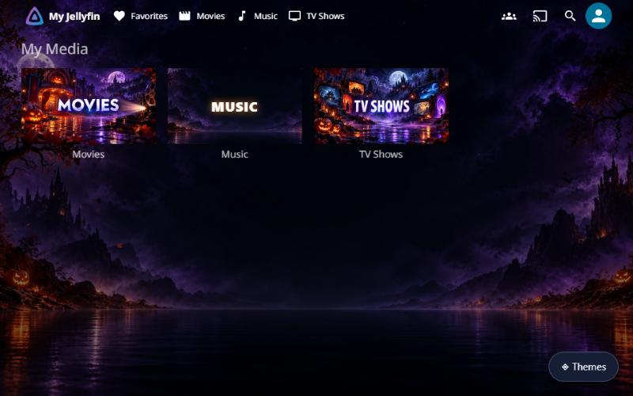
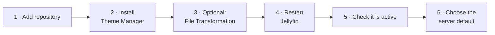
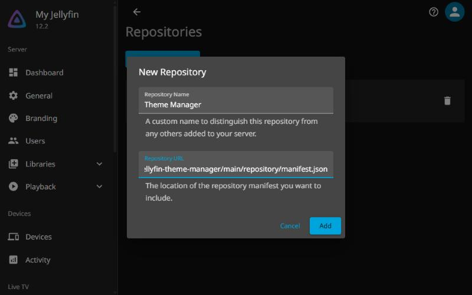
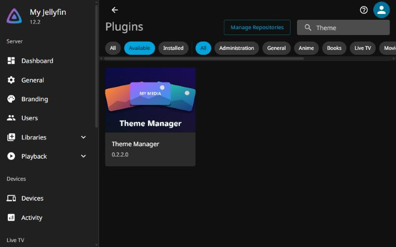
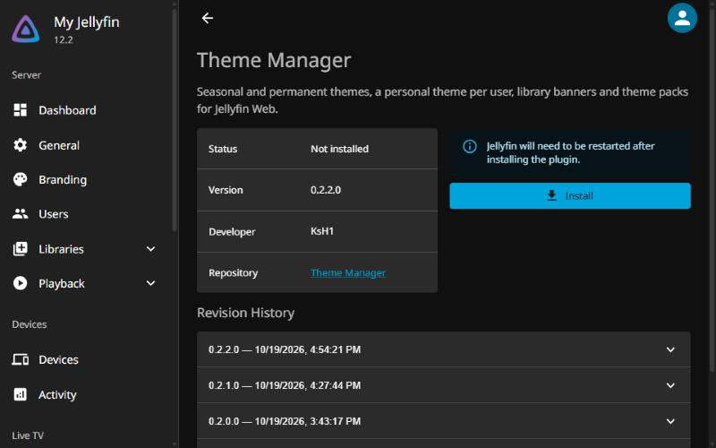
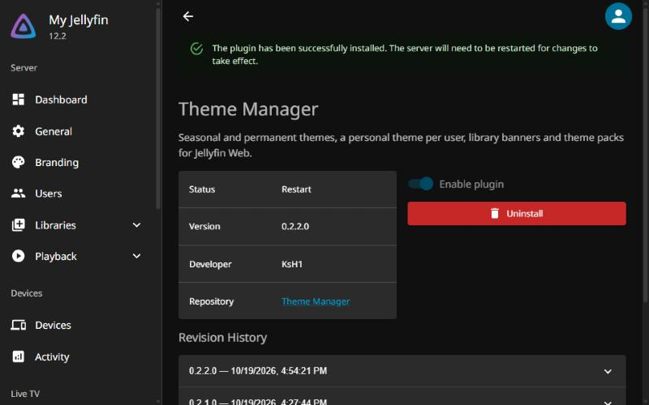
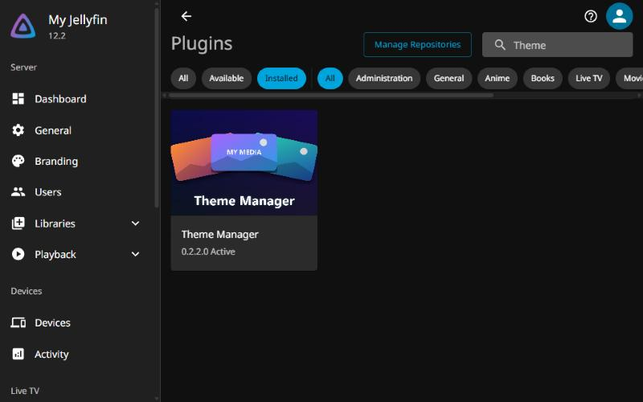
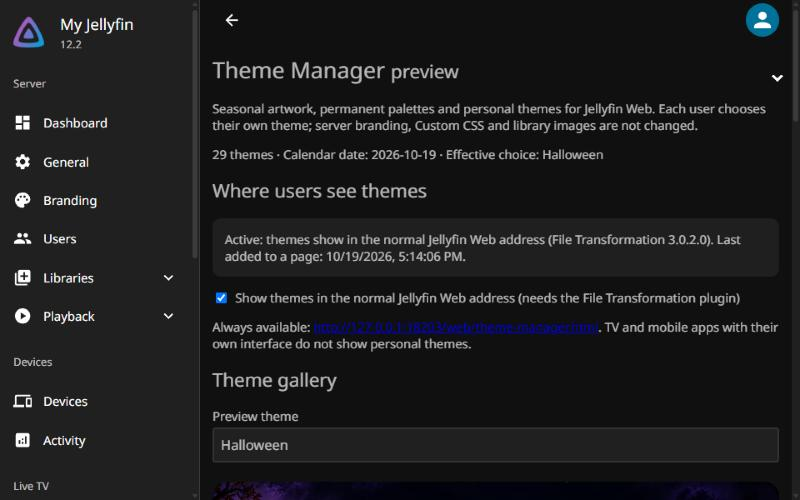
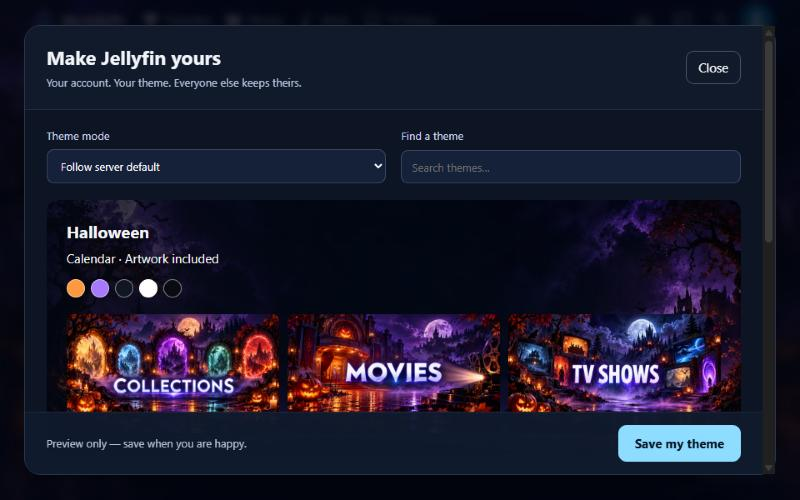
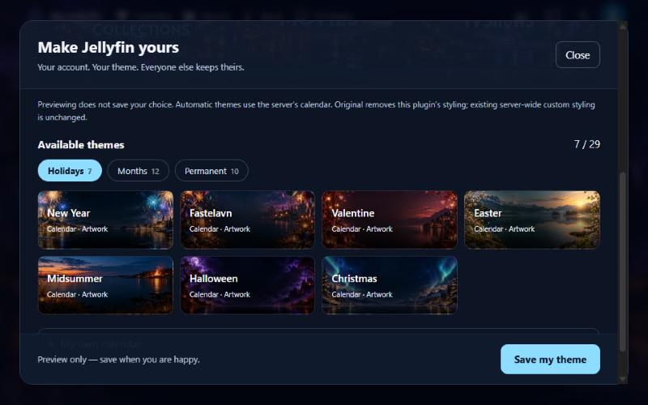

# Theme Manager for Jellyfin


Seasonal and permanent themes for Jellyfin Web. Each user picks their own theme, follows the server default, or uses a calendar. Library cards get themed banners; any library without its own banner gets one with its name. Server branding, Custom CSS and library images are not changed.

**Status:** preview, for **Jellyfin 12.0, 12.1 and 12.2**. Each Jellyfin version gets its own build; Jellyfin picks the right one. 12.2 is tested on a running server; the 12.0 and 12.1 builds are compiled against those versions but not yet tested on a running server. Jellyfin 10.x is not supported.



## Install

About five minutes. You need to be a Jellyfin administrator.



### 1. Add the repository

**Dashboard → Plugins → Manage Repositories → New Repository**. Use any name, for example *Theme Manager*, and this URL:

```text
https://raw.githubusercontent.com/KsH1/jellyfin-theme-manager/main/repository/manifest.json
```

Click **Add**.



### 2. Install Theme Manager

Go back to **Plugins**, choose **Available** and search for *Theme*. Click **Theme Manager**.



Click **Install**. Jellyfin asks you to confirm that you trust a third-party plugin; click **Install** again.



### 3. Optional: show themes at the normal address

Without this step, themes work at `<your server>/web/theme-manager.html`. With it, everyone sees their theme at the normal Jellyfin address.

1. Add a second repository: `https://www.iamparadox.dev/jellyfin/plugins/manifest.json`
2. Install **File Transformation** the same way as Theme Manager.

File Transformation adds the theme to Jellyfin Web as the page is sent; no Jellyfin files are changed. You can switch this off later on Theme Manager's settings page.

### 4. Restart Jellyfin

Jellyfin shows *The server will need to be restarted*.



Stop Jellyfin completely and start it again:

| Jellyfin runs as | Restart |
|---|---|
| Windows tray app | Right-click the tray icon, quit, and start Jellyfin again |
| Windows service | Restart the Jellyfin service in Windows **Services** |
| Linux package | `sudo systemctl restart jellyfin` |
| Docker | `docker restart <container>` |

For a first install, **Dashboard → Restart** also works. For an **update**, it does not: it keeps the old plugin version loaded, so stop and start Jellyfin as above.

### 5. Check it is active

Under **Plugins → Installed**, Theme Manager shows its logo and **Active**.



### 6. Choose the server default

Click Theme Manager to open its settings:

- **Where users see themes** says *Active* when File Transformation is in use.
- **Server default** is *Automatic Seasonal*: the month's theme, with holidays taking over on their dates.
- The 29 standard themes are installed automatically on first start.



## Using it

Users reload Jellyfin Web once after the install. The **Themes** button (bottom right) opens the theme picker. Each user's choice is saved to their own account, so other users keep theirs.



Themes are grouped in tabs: Holidays, Months, Permanent and your own (Custom). Search looks through all tabs.



**Your own themes and calendars:** see [docs/CUSTOM-THEMES.md](docs/CUSTOM-THEMES.md). A ready-to-import example is in [`examples/sample-aurora.zip`](examples/sample-aurora.zip).

The 29 standard themes (`default-packs/`) are 19 calendar themes with artwork (months and holidays) and 10 colour themes. A theme that already exists is never overwritten, and a standard theme an administrator deletes is not brought back.

## Troubleshooting

| You see | Do this |
|---|---|
| A puzzle-piece image, and a message that the plugin details could not be fetched from the repository | The repository from step 1 is missing. Add it and reload the page. |
| Theme Manager is not in **Available** | Check the repository URL, then reload the page. Your Jellyfin must be 12.0, 12.1 or 12.2; Jellyfin hides plugins built for other versions. |
| No theme and no **Themes** button at the normal address | Check that **Where users see themes** says *Active*. If it says File Transformation is missing, do step 3 and restart. Otherwise reload the page. |
| Status *NotSupported* | The installed build does not match your Jellyfin version. Uninstall it and install again from **Available**. |
| An update does not take effect | Stop and start Jellyfin completely (step 4), not Dashboard → Restart. |
| TV or phone app without the theme | Expected: apps with their own interface do not show personal themes. Use Jellyfin Web in a browser. |

To rebuild the standard packs from full-size PNGs: `python scripts/convert_packs_to_webp.py` (needs Pillow).

---

## Features

- A personal theme per user: follow the server default, Automatic Seasonal, a fixed theme, a calendar, or original Jellyfin. Saved per Jellyfin account.
- Automatic Seasonal: monthly themes plus holidays (New Year, Valentine's Day, Fastelavn, Easter, Midsummer, Halloween, Christmas); Easter-based dates are calculated each year.
- Custom calendars: shared calendars made by an administrator, and one personal calendar per user.
- Library banners on the home screen for every library, with a generic banner showing the library's name where a theme has no specific banner.
- Theme picker with category tabs, search and live preview; previews use small copies made by the server.
- Theme packs as data only (`theme.json` + images): no scripts or CSS are accepted from uploads.
- Fail-safe: a broken pack or plugin error never stops Jellyfin; the reason goes to the server log.

## Build and test

Requirements: .NET SDK 10 and PowerShell 7 for the scripts.

```powershell
dotnet restore ThemeManager.slnx --locked-mode
dotnet test ThemeManager.slnx -c Release --no-restore
node --test tests/client/core.test.mjs
.scriptsBuild-Package.ps1                      # tests, builds, artifacts/build-<time>/
.scriptsTest-IsolatedServer.ps1                # throw-away Jellyfin on loopback port 18196
.scriptsTest-DefaultPacks.ps1 -Package artifactsuild-<time>
.scriptsTest-WebInjection.ps1 -FileTransformationDir <unzipped File Transformation>
.scriptsBuild-Repository.ps1 -Package artifactsuild-<time> -Changelog '...'   # repository/manifest.json + ZIP
```

The test scripts start the installed Jellyfin binary with new, empty data folders under `test-server/` (ignored by git). They never touch a running server on port 8096/18096. The version is set only in `Directory.Build.props`; bump it before `Build-Repository.ps1`, which never overwrites a published version.

## Layout

| Part | Location |
| --- | --- |
| Plugin, API, admin page and web client | `src/Jellyfin.Plugin.ThemeManager` |
| Catalog, calendar, preferences, pack install | `src/ThemeManager.Core` |
| Tests | `tests/ThemeManager.Tests`, `tests/client` |
| Standard themes shipped with the plugin | `default-packs` |
| Examples | `examples` |
| Jellyfin plugin repository | `repository` |
| Docs (status, plan, pack format) | `docs` |

On a server, packs live in `<data>/theme-manager/packs/<id>/`, user choices in `<data>/theme-manager/users/`, and server settings in Jellyfin's own plugin configuration.

All API routes start with `/ThemeManager` and require a Jellyfin login; `Admin/*` requires an administrator. A user's identity always comes from their session, never from a user id in the request, and API keys cannot act as a personal user.

## Licence

- Code: GPL-3.0-or-later, see [`LICENSE`](LICENSE).
- Artwork in `default-packs/` and `examples/`: AI-generated, released under CC0 1.0 (no rights reserved), see [`ARTWORK-LICENSE.md`](ARTWORK-LICENSE.md).
